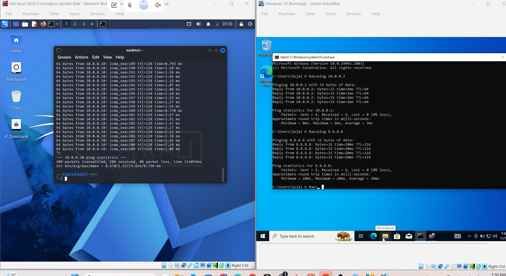
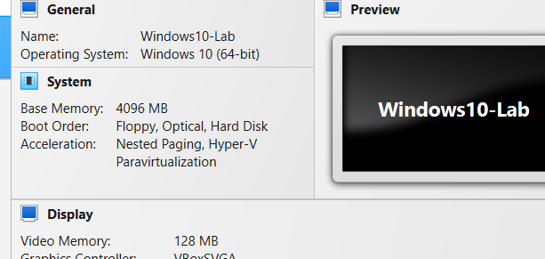

# Windows 10 and Kali Linux VirtualBox Lab

**Author:** Sujal K Rao  
**Program:** NETWORKWALKS Cybersecurity Internship  
**Batch:** B084D | **Week:** 1 | **Project:** Windows 10 extra lab

## Objective

Install Windows 10 in VirtualBox, connect it to the same NAT Network as Kali Linux, assign the lab's static IPv4 settings, and verify communication in both directions and Windows internet access.

## Lab configuration

| Setting | Windows | Kali |
|---|---|---|
| Operating system | Windows 10 Pro (64-bit) | Kali Linux 2026.3 |
| VirtualBox network mode | NAT Network | Same NAT Network |
| IPv4 address | 10.0.0.10 | 10.0.0.2 |
| Subnet mask | 255.255.255.0 | /24 |
| Gateway | 10.0.0.1 | 10.0.0.1 |

Windows preferred DNS: **8.8.8.8**.  
Windows VM name: **Windows10-Lab**.  
Windows memory: **4096 MB (4 GB)**.  
Windows virtual disk: **50 GB VDI**, exceeding the guide's 40 GB minimum.

These addresses belong to the private training lab.

## Setup performed

1. Created a Windows 10 (64-bit) virtual machine and attached the installation ISO.
2. Used manual installation, selected Windows 10 Pro, and installed to the new virtual disk.
3. Completed initial account setup with a local account.
4. Shut down Windows and changed Adapter 1 from NAT to **NAT Network**, selecting the same network used by Kali.
5. Set the Windows static IPv4 address, subnet mask, gateway, and DNS shown above through the Ethernet adapter's IPv4 properties.
6. Started both virtual machines and tested connectivity.
7. Renamed the Windows VM to Windows10-Lab and set its base memory to 4096 MB.

## Verified results

| Test | Command | Observed result |
|---|---|---|
| Windows to Kali | `ping 10.0.0.2` | 4 sent, 4 received, 0% loss |
| Windows to internet | `ping 8.8.8.8` | 4 sent, 4 received, 0% loss; 20 ms replies |
| Kali to Windows | `ping 10.0.0.10` | 209 transmitted, 209 received, 0% loss |

Pinging an external IP verifies IP connectivity; it does not separately test DNS name resolution.

## Troubleshooting

### Installer appeared again after restart

The Windows installation ISO remained attached and the VM booted into Windows Setup again. Removed the ISO using **Devices > Optical Drives > Remove disk from virtual drive**, then reset the VM. The existing Windows login appeared; reinstalling was unnecessary.

### Kali could not initially ping Windows

Windows could ping Kali, but Kali's ping to Windows showed no replies. Checked Windows Defender Firewall with Advanced Security and confirmed the **Private** profile was active. Enabled the Private-profile **File and Printer Sharing (Echo Request - ICMPv4-In)** rule. Retesting from Kali succeeded with zero packet loss. The firewall remained enabled.

## Evidence

### Bidirectional connectivity and Windows internet access

The screenshot shows Windows to Kali and Windows to internet on the right, and Kali to Windows with the final packet statistics on the left.

### Final VM name and memory

## Guide alignment

- [x] Windows 10 installed in VirtualBox.
- [x] Virtual disk exceeds 40 GB.
- [x] Windows VM configured with 4 GB memory.
- [x] Windows and Kali use the same NAT Network.
- [x] Windows static address matches the guide.
- [x] Windows can reach Kali and an internet IP.
- [x] Kali can reach Windows.
- [x] Screenshot shows successful pings in both directions.

**Reference:** WK1-PMx - Windows10 VirtualBox Guide v1.pdf, pages 1, 4, and 5. The original training PDF and Windows installation media are not redistributed here.

## Submission

This repository documents the Windows 10 extra project separately from the earlier Kali setup and Wireshark repositories. Final course-form submission is completed separately according to the program's instructions.
